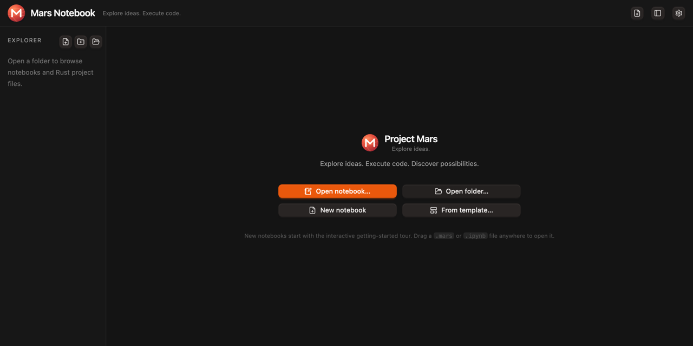
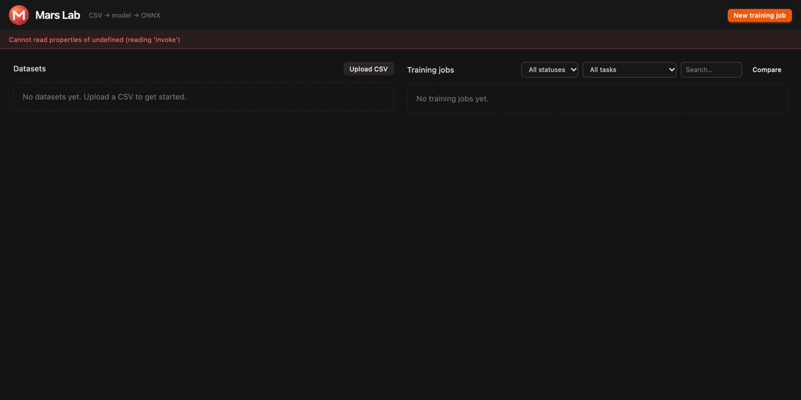
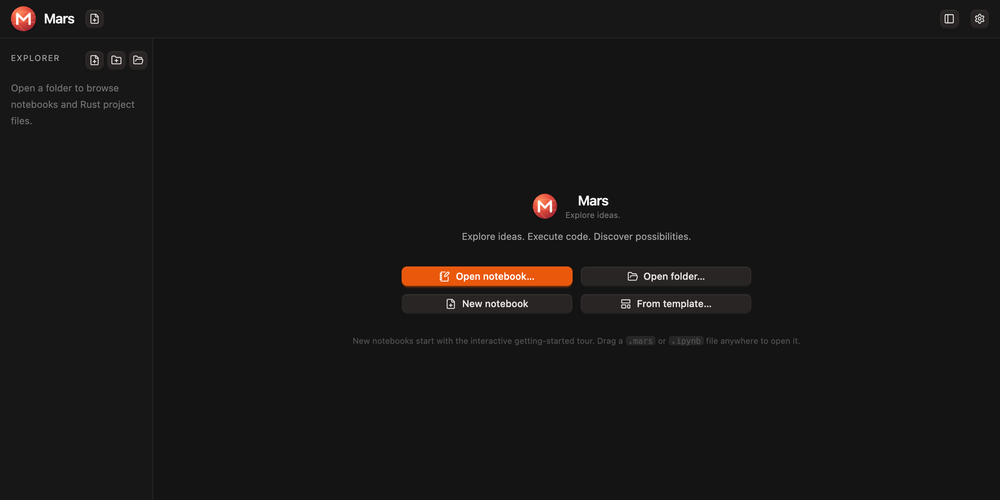

# Project Mars

**Mars is a Rust-powered interactive computing platform that combines
multi-language executable notebooks with an integrated machine-learning
studio.** It is an independent open-source project — not a Jupyter frontend —
with its own document format, execution engine, protocol, CLI, desktop app,
and rendering pipeline.

[![CI][badge-ci]][link-ci] [![License: MIT][badge-license]][link-license] [![Rust][badge-rust]][link-rust] [![Desktop][badge-desktop]][link-desktop] [![MCP][badge-mcp]][link-mcp]

**Explore ideas. Execute code. Discover possibilities.**

- [Live demo](https://hieudoanm.github.io/mars/)
- [Install](#installation)
- [Releases](https://github.com/hieudoanm/mars/releases)
- [Support Mars](#support-mars)

Topics: `notebook` · `rust` · `tauri` · `mcp` · `vscode-extension` · `machine-learning`

---

## Two products, one platform

### Mars Notebook

An interactive notebook environment for code, Markdown, mathematics, tables,
charts, and rich output — in a native, versioned `.mars` document with
Jupyter `.ipynb` import/export.

- **Languages:** Rust, Python, R, Julia, C++, and SQL — each behind a
  `RuntimeBackend` trait, running in an isolated child process (SQL is
  in-process SQLite).
- **Execution:** `mars-kernel` owns persistent per-language sessions;
  `mars-protocol` defines typed requests/responses; `mars-renderer` produces
  HTML, Markdown, slides, PDF, and `.ipynb` exports.
- **Editing:** a Tauri 2 + React desktop app with a CodeMirror editor,
  rust-analyzer diagnostics over LSP, cell comments, run-from-cell, and
  slides export.
- **Automation:** `mars notebook …` works fully headless — create, run,
  inspect, diff, export — plus `mars kernel serve` (JSONL over stdio/TCP)
  and an MCP server for AI assistants.
- **Ecosystem:** VS Code, Zed, and JetBrains extensions.

### Mars Lab

_Machine learning in Rust_ — a studio that turns CSV datasets into trained
ONNX models.

- **Pipeline:** CSV upload → profiling → column mapping → algorithm selection
  → training → metrics/charts → ONNX export.
- **Catalogue:** 83 algorithms across classification, regression,
  semi-supervised learning, clustering, anomaly detection, and offline
  reinforcement learning.
- **Surfaces:** `mars lab …` CLI and a Lab view inside the desktop app.
- **Storage:** SQLite (sqlx, WAL) for datasets, jobs, metrics, and artefacts;
  dataset files under `.mars-lab-data/`.

---

## Why Mars

Mars grew out of a personal interest in Rust and its potential for data
science, machine learning, and interactive computing. The ambition is to
explore how Rust can become an increasingly practical and approachable choice
for ML and scientific computing — and to find out, honestly, where it works
well and where it doesn't.

It is a personal open-source project developed in spare time. Expect a fast,
opinionated codebase, real documentation, and a willingness to change course
based on what the community finds useful. Bug reports, feature ideas, and
architecture discussions are all welcome — see [Contributing](#contributing).

---

## See it in action

Real captures of the current application — no mockups.

**Mars Notebook** — Markdown cells render as prose, Rust cells get syntax
highlighting and persistent variables, and outputs (text, errors, tables,
images, charts) appear inline beneath each cell:



**Mars Lab** — upload CSV datasets, train models with 83 algorithms, and
export ONNX artefacts:




**From the terminal** — the same `mars` CLI drives everything headless:


Or watch the animated capture: [`assets/demo/gif/demo.gif`](assets/demo/gif/demo.gif).

The desktop welcome screen routes between the two products:



Demo assets live in [`assets/demo/`](assets/demo/) and are regenerated with
[`scripts/sh/screenshot.sh`](scripts/sh/screenshot.sh) and
[`assets/demo/svg-to-gif.sh`](assets/demo/svg-to-gif.sh).

---

## Features & architecture

The repository is a Cargo workspace (`crates/`) plus a pnpm/Turborepo Node
workspace (`packages/`, `extensions/`). Domain logic lives in Rust; the
desktop frontend stays thin.

| Crate                                                          | Responsibility                                         |
| -------------------------------------------------------------- | ------------------------------------------------------ |
| `mars-core`                                                    | Shared domain types, IDs, errors                       |
| `mars-document`                                                | `.mars` notebook model, validation, atomic persistence |
| `mars-runtime` + `mars-runtime-{python,r,julia,cpp,sql,evcxr}` | Per-language execution backends                        |
| `mars-kernel`                                                  | Session lifecycle, language dispatch, cancellation     |
| `mars-protocol`                                                | Typed frontend↔kernel messages                         |
| `mars-renderer`                                                | HTML / Markdown / slides / PDF / `.ipynb` export       |
| `mars-jupyter`                                                 | `.ipynb` import/export                                 |
| `mars-lsp`                                                     | rust-analyzer LSP client for the editor                |
| `mars-cli`                                                     | The `mars` binary (notebook, lab, kernel, mcp, tools)  |
| `mars-mcp`                                                     | MCP server (JSON-RPC over stdio)                       |
| `mars-lab`                                                     | Mars Lab core + SQLite repositories                    |
| `mars-tauri` (`packages/desktop/src-tauri`)                    | Tauri host for the desktop app                         |

Notable capabilities:

- **Native `.mars` format** — versioned JSON with stable cell IDs, metadata
  (comments, attachments, previews, SQL tables), migrations, and atomic saves.
- **Multi-language cells** — Rust (replay + opt-in Evcxr backend), Python,
  R, Julia, C++, and SQL; sessions persist variables across cells.
- **Rich output** — text, errors, HTML (sanitized), images, tables, LaTeX,
  Vega-Lite charts, MIME bundles.
- **Cell-aware tooling** — `mars notebook diff`, `--changed-only`/`--since`
  execution, `--watch` re-runs, `--report`/`--json-report` for CI, and
  `mars notebook doctor` runtime probes.
- **Publish anywhere** — `export html`/`slides` produce fully self-contained
  documents (inline CSS, data-URI attachments).
- **MCP server** — notebook and kernel operations exposed to AI assistants;
  `mars tools list|call` is a built-in MCP client.
- **Mars Lab** — 83 algorithms, dataset profiling, job comparison, metrics and
  charts, ONNX export; deterministic seeded trainers, no I/O in trainers.

Experimental / opt-in: the **Evcxr** Rust backend (`experimental-evcxr`
Cargo feature) and the **evcxr-experiment** appendix doc. Everything else is
the default, tested path.

---

## Installation

> **Status:** there is no official GitHub release yet — the release pipeline
> exists but no tagged build has been published. Install from source for now;
> watch [Releases](https://github.com/hieudoanm/mars/releases) for binaries.

### A. CLI users

Prerequisites: [Rust](https://rustup.rs/) (MSRV 1.85; the repo pins 1.100.0
via `rust-toolchain.toml`), plus the language runtimes you intend to use
(`python3`, `Rscript`, `julia`, `clang++`/`g++` — check with
`mars notebook doctor`).

```bash
git clone https://github.com/hieudoanm/mars.git
cd mars
cargo install --path crates/mars-cli        # installs the `mars` binary

mars notebook new analysis.mars             # verify the install
mars notebook run analysis.mars
mars notebook templates                     # built-in templates + examples
mars lab algorithms --task classification   # Mars Lab catalogue
```

### B. Desktop users

The desktop app (Tauri 2) currently builds from source; prebuilt installers
will ship with the first release. Supported hosts: macOS, Linux, Windows.

Prerequisites: Rust, Node.js **26.13.1** (pinned in `.nvmrc`), pnpm **12.21.0**
(pinned via `packageManager`), and the Tauri platform prerequisites for your OS
(see [`docs/05-development/development.md`](docs/05-development/development.md)).

```bash
corepack enable
corepack prepare pnpm@12.21.0 --activate
pnpm install
pnpm --filter @mars/desktop dev              # dev server + Tauri shell
# or: ./scripts/sh/install-local.sh --desktop  (release build + install)
```

The desktop app embeds the kernel — no separate `mars` CLI install needed.

### C. Contributors

See [Contributing](#contributing) and
[`docs/05-development/development.md`](docs/05-development/development.md).

| Tool                 | Version                               |
| -------------------- | ------------------------------------- |
| Rust (MSRV)          | 1.85 (`rust-version` in `Cargo.toml`) |
| Rust (dev toolchain) | 1.100.0 (`rust-toolchain.toml`)       |
| Node.js              | 26.13.1 (`.nvmrc`, `engines`)         |
| pnpm                 | 12.21.0 (`packageManager`)            |
| JDK                  | 17+ (JetBrains extension only)        |

```bash
git clone https://github.com/hieudoanm/mars.git && cd mars
cargo test --workspace          # Rust tests + coverage gate: make coverage
pnpm install && pnpm run check  # typecheck/lint/test across Node packages
```

Per-job CI equivalents live in [`scripts/sh/ci/`](scripts/sh/ci/).

---

## Documentation

Full docs are grouped into numbered chapters — index at
[`docs/README.md`](docs/README.md). Highlights:

- [Getting started](docs/01-foundations/getting-started.md) ·
  [Notebook format](docs/01-foundations/notebook-format.md) ·
  [Architecture](docs/01-foundations/architecture.md)
- [CLI reference](docs/02-platform/cli.md) ·
  [Protocol](docs/02-platform/protocol.md) ·
  [Kernel protocol](docs/02-platform/kernel-protocol.md) ·
  [Runtime architecture](docs/02-platform/runtime.md)
- [Mars Lab overview](docs/03-lab/lab-overview.md) ·
  [Lab CLI](docs/03-lab/lab-cli.md) ·
  [Algorithms](docs/03-lab/lab-algorithms.md) ·
  [Workflows](docs/03-lab/lab-workflows.md)
- [VS Code](docs/04-extensions/extension-vscode.md) ·
  [Zed](docs/04-extensions/extension-zed.md) ·
  [JetBrains](docs/04-extensions/extension-jetbrains.md)
- [Development](docs/05-development/development.md) ·
  [Release process](docs/05-development/release.md)

The same content is published on the
[landing site](https://hieudoanm.github.io/mars/docs/) with a blog.

---

## Project status

- **Working today:** the `mars` CLI (notebook + lab + kernel serve + MCP),
  the Tauri desktop app, all six language runtimes, Jupyter import/export,
  HTML/Markdown/slides/PDF export, editor extensions, and Mars Lab's full
  train→ONNX pipeline.
- **In progress:** the first tagged release (pipeline exists, no published
  binaries yet), WebSocket/remote kernel transport, real-time collaboration.
- **Known limitations:** Rust execution replays accumulated cells (side
  effects re-run for `variables` inspection); the Evcxr backend is opt-in and
  experimental; desktop e2e automation is Linux/Windows-only.

CI runs format, clippy, workspace tests, coverage gates, desktop checks,
landing build, extension builds, and the Tauri e2e suite on every push/PR.

---

## Contributing

Mars is a personal project, but it is built to be picked up. Good first
contributions:

- **Bug reports and docs fixes** — [Issues](https://github.com/hieudoanm/mars/issues)
- **Runtime/language integrations** — new `RuntimeBackend` implementations
- **Mars Lab** — algorithms, metrics, ONNX export improvements
- **Architecture discussions** — [Discussions](https://github.com/hieudoanm/mars/discussions) if enabled, otherwise Issues

Please read [`CONTRIBUTING.md`](CONTRIBUTING.md) first — it covers the
toolchain, workspace conventions, and the Rust coverage gate (80% lines and
functions).

---

## Support Mars

Mars is an independent open-source project developed in my spare time. If you
find it useful or would like to support its development, consider donating on
[Ko-fi](https://ko-fi.com/hieudoan) or [PayPal](https://paypal.me/hieudoanm).

My current funding goal is to obtain an **Apple Developer Program**
membership so I can improve the macOS distribution experience and explore
wider distribution options for Mars.

Contributions help cover development and distribution costs. Thank you for
supporting independent open-source software.

---

## License

[MIT](LICENSE) © hieudoan

<!-- Badge reference links -->

[badge-ci]: https://github.com/hieudoanm/mars/actions/workflows/ci.yaml/badge.svg?branch=master
[link-ci]: https://github.com/hieudoanm/mars/actions/workflows/ci.yaml?branch=master
[badge-license]: https://img.shields.io/badge/license-MIT-blue.svg
[link-license]: LICENSE
[badge-rust]: https://img.shields.io/badge/rust-1.85%2B-orange.svg
[link-rust]: https://github.com/hieudoanm/mars/blob/master/rust-toolchain.toml
[badge-desktop]: https://img.shields.io/badge/desktop-Tauri%202-24c8d8.svg
[link-desktop]: https://github.com/hieudoanm/mars/tree/master/packages/desktop
[badge-mcp]: https://img.shields.io/badge/MCP-supported-8b5cf6.svg
[link-mcp]: docs/02-platform/mcp.md

### Streamable HTTP

`mars mcp serve --http 127.0.0.1:8080` also accepts `--http <addr>` (and `--token <token>`, or the
`MCP_AUTH_TOKEN` environment variable) to serve the same MCP surface over
streamable HTTP at `http://<addr>/mcp` — the transport used by ChatGPT
connectors and remote Claude clients. When a token is configured, every
request must carry `Authorization: Bearer <token>`.
