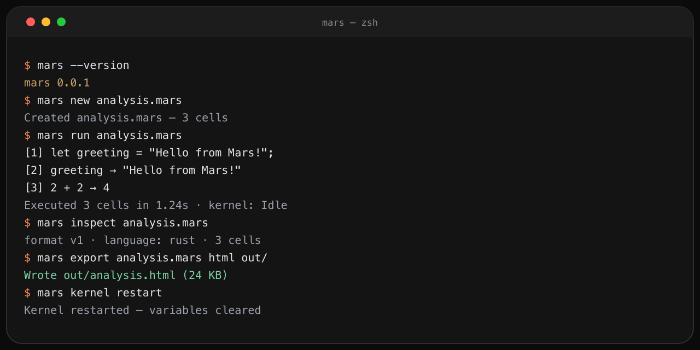
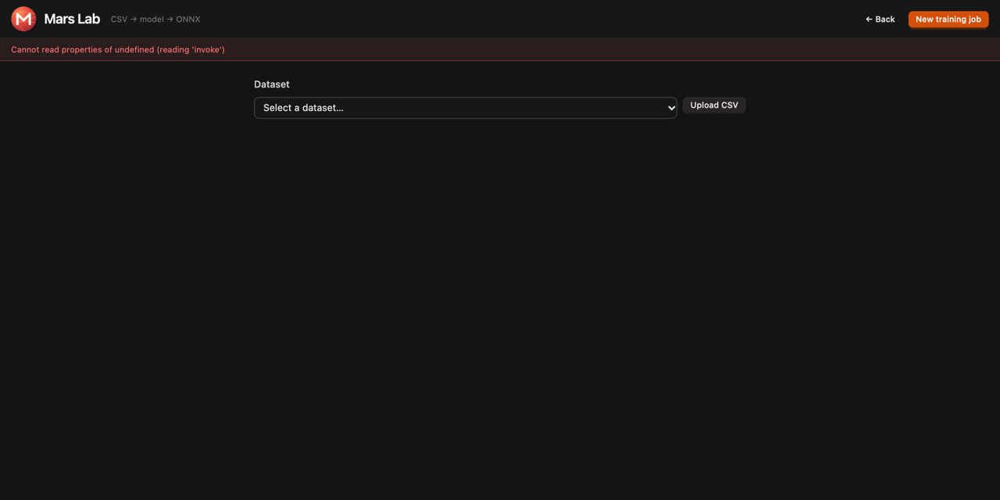

# Mars - Machine Learning in Rust

[](https://github.com/hieudoanm/mars/actions/workflows/ci.yaml?branch=master)  [](LICENSE)  [](rust-toolchain.toml)  [](packages/desktop)  [](docs/02-platform/mcp.md)  [](Makefile)

Topics: `notebook`, `rust`, `tauri`, `mcp`, `vscode-extension`


**Live demo:** <https://hieudoanm.github.io/mars/>

**Project Mars** — Explore ideas. Execute code. Discover possibilities.

## Table of Contents

- [Mars - Machine Learning in Rust](#mars---machine-learning-in-rust)
  - [Table of Contents](#table-of-contents)
  - [Features](#features)
  - [Get Started](#get-started)
    - [CLI](#cli)
    - [Node workspace](#node-workspace)
    - [Desktop application](#desktop-application)
  - [Demo](#demo)
  - [VS Code extension](#vs-code-extension)
  - [Documentation](#documentation)
  - [Landing site](#landing-site)
  - [License](#license)

**Supported languages:** Rust · Python · R · Julia · C++

## Features

**Mars Notebook** — Interactive computing platform:

- Multi-language notebook platform supporting Rust, Python, R, Julia, and C++.
- Typed notebook documents, validation, and atomic persistence.
- Isolated execution with per-language persistent sessions.
- Rust: replay-based and experimental Evcxr backends with Cargo dependencies.
- Python: persistent driver with matplotlib and top-level await.
- R: persistent driver with plot capture and `.GlobalEnv` binding.
- Julia: persistent driver with MIME bundles and interactive input.
- C++: replay-based compilation with Conan/vcpkg dependencies.
- Jupyter conversion with common rich MIME outputs.
- Sanitized HTML rendering with KaTeX math and Vega-Lite charts.
- Model Context Protocol (MCP) server for AI assistant integration.

**Mars Lab** — Machine learning training studio:

- 83 ML algorithms across 6 task types (classification, regression, clustering, anomaly detection, semi-supervised, reinforcement learning).
- CSV dataset management with automatic type inference and missing value detection.
- Pure Rust training pipeline with metrics, charts, and ONNX export.
- SQLite persistence for datasets, jobs, and artefacts.
- Job comparison and model versioning.
- Desktop UI and CLI access for headless training.

**Shared platform:**

- Functional Tauri desktop editor with multi-notebook workspace, LSP integration, and rich UI.
- Next.js landing site with comprehensive documentation and VS Code/Zed/JetBrains extensions.

## Get Started

### CLI

- Install Rust 1.85 or newer.
- Run Project Mars directly from the workspace:

```bash
# Notebook commands
cargo run -p mars -- notebook new analysis.mars
cargo run -p mars -- notebook inspect analysis.mars
cargo run -p mars -- notebook run analysis.mars
cargo run -p mars -- notebook import notebook.ipynb analysis.mars
cargo run -p mars -- notebook export analysis.mars ipynb notebook.ipynb
cargo run -p mars -- notebook export analysis.mars html analysis.html
cargo run -p mars -- notebook export analysis.mars md analysis.md

# Lab commands
cargo run -p mars -- lab algorithms --task classification
cargo run -p mars -- lab dataset data.csv
cargo run -p mars -- lab train --dataset-id <uuid> --task classification --algorithm random_forest_classifier --features age,income --label target

cargo test --workspace
```

### Node workspace

- Uses pnpm and Turborepo.
- Core commands:

```bash
corepack enable
corepack prepare pnpm@12.18.0 --activate
pnpm install
pnpm run check
pnpm run build
```

- Workspace packages: `@mars/desktop`, `@mars/vscode`, `@mars/landing`.
- `pnpm run dev` starts development tasks in parallel.
- Filter a task with `pnpm turbo run build --filter=@mars/landing`.
- Installed CLI binary:

```bash
cargo install --path crates/mars-cli
mars notebook new analysis.mars
mars lab algorithms --task classification
```

### Desktop application

- Install stable Rust toolchain, Node.js 20+, and platform prerequisites in [`docs/05-development/development.md`](docs/05-development/development.md).
- Run:

```bash
cd packages/desktop
npm install
npm run tauri dev
```

- Root workspace equivalent:

```bash
pnpm --filter @mars/desktop dev
```

- Desktop application is the canonical interactive notebook experience.
- Native release bundles:

```bash
npm run tauri build
```

- See [`docs/05-development/release.md`](docs/05-development/release.md) for signing, platform targets, and artifact verification.

- `mars notebook run` reports each executable cell's position, execution count, duration, output count, and captured output.
- Failed cells persist partial results and exit unsuccessfully after reporting.
- Long-running cells can be bounded with `mars notebook run analysis.mars --timeout-ms 5000`.
- Timed-out cells are marked interrupted and not committed to the persistent runtime session.

- The Rust cell editor integrates rust-analyzer over LSP: diagnostics,
  hover, completion, signature help, go-to-definition, quick fixes, inlay
  hints, and semantic-token highlighting; Markdown cells render GFM with
  heading anchors and `> [!NOTE]`-style alerts; long functions pin their
  signature via sticky scroll, bracket-pair colorization, and inlay hints;
  `mars_*` display helpers autocomplete with snippets, table outputs filter
  and sort, and the problems panel cycles diagnostics.
- See `AGENTS.md` for product architecture and development strategy.
- Contributor docs: `CONTRIBUTING.md`, `docs/01-foundations/architecture.md`, `docs/01-foundations/notebook-format.md`, `docs/02-platform/runtime.md`, `docs/02-platform/cli.md`, `docs/02-platform/protocol.md`, `docs/05-development/development.md`, `docs/05-development/release.md`, `docs/06-appendix/branding.md`.

- Execution runtime recompiles accumulated cells in an isolated temporary program.
- Preserves Rust bindings between cells without executing notebook code in the CLI process.
- Earlier side effects are replayed.
- Conservative final expression rendered automatically with `Debug`, with `Display` fallback.
- Multiline expressions and trailing line comments supported.
- Item declarations and statement-only cells require explicit output.
- Runtime timeouts cover both compilation and execution, terminating the active child process when the total cell limit expires.

- HTML export renders Markdown, code, text, errors, tables, images (including base64 PNG and inline SVG MIME bundles), sanitized HTML outputs, common LaTeX expressions, and supported line/point/bar chart specifications into a standalone dark-themed document.
- Markdown export preserves Markdown cells, fences Rust code, and converts outputs into Markdown tables, `$$` LaTeX blocks, and data-URI images for portability across Git forges and static-site generators.
- Unknown MIME bundles represented safely as fallback blocks.

- Rust notebooks may declare registry dependencies in `metadata.dependencies`, for example `{ "serde": "1" }`.
- Project Mars creates a temporary Cargo project for those notebooks.
- Dependency resolution uses Cargo's configured cache and registry and may require network access.

- Desktop shell under `packages/desktop`.
- Run `npm install` there for package-local workflow, or install root pnpm workspace as above.
- Run `npm run tauri dev` to launch Tauri application.
- Editor keeps notebook cells in frontend and delegates Rust execution, reset, and status to typed Tauri commands backed by `mars-kernel`.

- Desktop editor supports running one cell, all cells, cells above or below the current cell, clearing outputs, and core notebook keyboard shortcuts.
- Notebook toolbar accepts optional execution limit in milliseconds; blank preserves unlimited execution.
- While a cell runs, Stop requests cancellation of the active compiler or runtime process.
- Opened notebooks show unsaved state and autosave after a short idle period.
- Untitled notebooks require an explicit Save destination.
- Opening another notebook while current one is dirty offers Cancel, Open without saving, and Save and open.
- Closing the desktop window uses the same protection.

- Desktop browser smoke tests use Playwright and cover editor shell and basic cell workflows:

```bash
cd packages/desktop
npm run test:e2e
```

- Tests run against Vite and do not yet launch the native Tauri shell.

## Demo

Project Mars fits into a real workflow — start in the terminal, then move to the desktop when you want a visual editor.

**From the command line.** Create a notebook, run every cell, inspect it, and export it to HTML — all headless, scriptable, and CI-friendly.



Or watch it run: [`assets/demo/gif/demo.gif`](assets/demo/gif/demo.gif) animates the same session line by line.

**Into the desktop app.** Launch `mars-desktop` (or the Tauri build) and pick your workspace — Notebook for interactive computing or Lab for machine learning.


**Mars Notebook.** Markdown cells render as prose, Rust cells get syntax highlighting and persistent variables, and outputs — text, errors, tables, images, and charts — appear inline beneath each cell.


**Mars Lab.** Upload CSV datasets, train models with 83 algorithms, and export ONNX artefacts — all in a visual interface.




Demo assets live in [`assets/demo/`](assets/demo/) (SVG sources in `svg/`, PNG exports in `png/`, animated captures in `gif/`). Regenerate the terminal SVG/PNG/GIF with [`assets/demo/svg-to-gif.sh`](assets/demo/svg-to-gif.sh) (requires `rsvg-convert` and `ffmpeg`). Regenerate the app captures with [`scripts/sh/screenshot.sh`](scripts/sh/screenshot.sh), which records the desktop UI at a 1280x640 ratio via the Vite dev server and Playwright. The social preview card is [`assets/branding/png/og.png`](assets/branding/png/og.png).

## VS Code extension

- Optional companion extension under [`extensions/vscode`](extensions/vscode).
- Provides `.mars` syntax highlighting, cell navigation, and CLI-backed HTML export.
- Tauri desktop app remains canonical notebook experience.
- Extension reuses Project Mars CLI rather than duplicating runtime or persistence layer.

## Documentation

Documents are grouped into numbered chapter folders; see [`docs/README.md`](docs/README.md) for the full index.

| Document                                                                                 | Purpose                                                      |
| ---------------------------------------------------------------------------------------- | ------------------------------------------------------------ |
| [`docs/01-foundations/getting-started.md`](docs/01-foundations/getting-started.md)       | Install, first notebook, and examples                        |
| [`docs/01-foundations/notebook-format.md`](docs/01-foundations/notebook-format.md)       | `.mars` schema, validation, migrations, and Jupyter mapping  |
| [`docs/01-foundations/architecture.md`](docs/01-foundations/architecture.md)             | Crate boundaries, application boundaries, and data flow      |
| [`docs/02-platform/protocol.md`](docs/02-platform/protocol.md)                           | Typed kernel messages and JSONL transport                    |
| [`docs/02-platform/kernel-protocol.md`](docs/02-platform/kernel-protocol.md)             | Detailed kernel protocol and transport options               |
| [`docs/02-platform/runtime.md`](docs/02-platform/runtime.md)                             | Runtime architecture overview                                |
| [`docs/02-platform/runtime-rust.md`](docs/02-platform/runtime-rust.md)                   | Rust replay and Evcxr backends                               |
| [`docs/02-platform/runtime-python.md`](docs/02-platform/runtime-python.md)               | Python persistent driver                                     |
| [`docs/02-platform/runtime-r.md`](docs/02-platform/runtime-r.md)                         | R `.GlobalEnv` persistence                                   |
| [`docs/02-platform/runtime-julia.md`](docs/02-platform/runtime-julia.md)                 | Julia `MarsKernel` module                                    |
| [`docs/02-platform/runtime-cpp.md`](docs/02-platform/runtime-cpp.md)                     | C++ replay compilation                                       |
| [`docs/02-platform/runtime-sql.md`](docs/02-platform/runtime-sql.md)                     | In-process SQLite runtime                                    |
| [`docs/02-platform/runtime-helpers.md`](docs/02-platform/runtime-helpers.md)             | Runtime helpers (`mars_table`, `mars_csv`, `mars_display_*`) |
| [`docs/02-platform/cli.md`](docs/02-platform/cli.md)                                     | CLI commands, options, exit behavior, and examples           |
| [`docs/02-platform/mcp.md`](docs/02-platform/mcp.md)                                     | Model Context Protocol integration                           |
| [`docs/03-lab/lab-overview.md`](docs/03-lab/lab-overview.md)                             | Mars Lab features and architecture                           |
| [`docs/03-lab/lab-cli.md`](docs/03-lab/lab-cli.md)                                       | Mars Lab CLI commands and examples                           |
| [`docs/03-lab/lab-algorithms.md`](docs/03-lab/lab-algorithms.md)                         | Complete algorithm catalogue                                 |
| [`docs/03-lab/lab-workflows.md`](docs/03-lab/lab-workflows.md)                           | Common training workflows                                    |
| [`docs/04-extensions/extension-vscode.md`](docs/04-extensions/extension-vscode.md)       | VS Code extension guide                                      |
| [`docs/04-extensions/extension-zed.md`](docs/04-extensions/extension-zed.md)             | Zed extension guide                                          |
| [`docs/04-extensions/extension-jetbrains.md`](docs/04-extensions/extension-jetbrains.md) | JetBrains plugin guide                                       |
| [`docs/05-development/development.md`](docs/05-development/development.md)               | Toolchains, local development, tests, and architecture rules |
| [`docs/05-development/release.md`](docs/05-development/release.md)                       | Native artifacts, verification, signing, and release CI      |
| [`docs/06-appendix/evcxr-experiment.md`](docs/06-appendix/evcxr-experiment.md)           | Evcxr backend experiment analysis                            |
| [`docs/06-appendix/branding.md`](docs/06-appendix/branding.md)                           | Canonical logo and social-preview assets                     |

## Landing site

The Next.js landing site (`packages/landing`) provides:

- Getting started guide and CLI reference
- Runtime documentation for all seven languages
- MCP integration documentation
- Extension guides for VS Code, Zed, and JetBrains
- Blog posts on language choices and ecosystem comparisons

Visit the documentation at [`packages/landing/md/docs/`](packages/landing/md/docs/).

## License

This project is licensed under the [MIT License](LICENSE).
