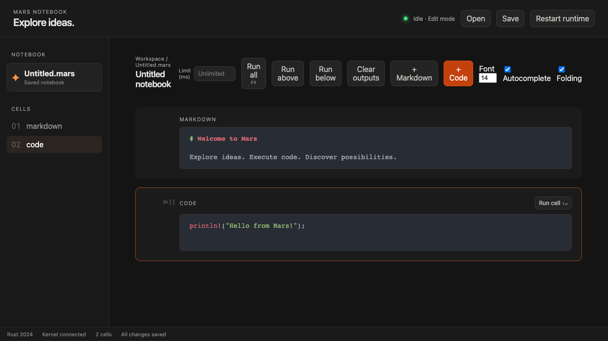

<p align="center">
  
</p>

<h1 align="center">Mars</h1>

<p align="center">
  Explore ideas. Execute code. Discover possibilities.
</p>

- Rust-first interactive notebook platform.
- Supports executable code, Markdown, mathematics, and rich output.
- Uses an independent `.mars` document format.
- Supports Jupyter import/export without being a Jupyter frontend.

## Status

- Early execution development.
- Typed notebook documents, validation, and atomic persistence.
- Cell operations and isolated replay-based Rust execution.
- Cargo-backed notebook dependencies.
- Jupyter conversion with common rich MIME outputs.
- Sanitized HTML rendering.
- Functional Tauri desktop editor.
- Next.js landing page with Markdown documentation and an optional VS Code
  companion in a pnpm/Turborepo workspace.

## Quick start

### CLI

- Install Rust 1.85 or newer.
- Run Mars directly from the workspace:

```bash
cargo run -p mars -- new analysis.mars
cargo run -p mars -- inspect analysis.mars
cargo run -p mars -- run analysis.mars
cargo run -p mars -- import notebook.ipynb analysis.mars
cargo run -p mars -- export analysis.mars ipynb notebook.ipynb
cargo run -p mars -- export analysis.mars html analysis.html
cargo run -p mars -- export analysis.mars md analysis.md
cargo test --workspace
```

### Node workspace

- Uses pnpm and Turborepo.
- Core commands:

```bash
corepack enable
corepack prepare pnpm@10.12.1 --activate
pnpm install
pnpm run check
pnpm run build
```

- Workspace packages: `@mars/desktop`, `@mars/vscode`, `@mars/landing`.
- `pnpm run dev` starts development tasks in parallel.
- Filter a task with `pnpm turbo run build --filter=@mars/landing`.
- Installed CLI binary:

```bash
cargo install --path crates/mars-cli
mars new analysis.mars
```

### Desktop application

- Install stable Rust toolchain, Node.js 20+, and platform prerequisites in [`docs/08-development.md`](docs/08-development.md).
- Run:

```bash
cd apps/desktop
npm install
npm run tauri dev
```

- Root workspace equivalent:

```bash
pnpm --filter @mars/desktop dev
```

- Desktop application is the canonical interactive notebook experience.
- Native release bundles:

```bash
npm run tauri build
```

- See [`docs/09-release.md`](docs/09-release.md) for signing, platform targets, and artifact verification.

- `mars run` reports each executable cell's position, execution count, duration, output count, and captured output.
- Failed cells persist partial results and exit unsuccessfully after reporting.
- Long-running cells can be bounded with `mars run analysis.mars --timeout-ms 5000`.
- Timed-out cells are marked interrupted and not committed to the persistent runtime session.

- See `AGENTS.md` for product architecture and development strategy.
- Contributor docs: `CONTRIBUTING.md`, `docs/04-architecture.md`, `docs/03-notebook-format.md`, `docs/06-runtime.md`, `docs/07-cli.md`, `docs/05-protocol.md`, `docs/08-development.md`, `docs/09-release.md`, `docs/02-branding.md`.

- Execution runtime recompiles accumulated cells in an isolated temporary program.
- Preserves Rust bindings between cells without executing notebook code in the CLI process.
- Earlier side effects are replayed.
- Conservative final expression rendered automatically with `Debug`, with `Display` fallback.
- Multiline expressions and trailing line comments supported.
- Item declarations and statement-only cells require explicit output.
- Runtime timeouts cover both compilation and execution, terminating the active child process when the total cell limit expires.

- HTML export renders Markdown, code, text, errors, tables, images (including base64 PNG and inline SVG MIME bundles), sanitized HTML outputs, common LaTeX expressions, and supported line/point/bar chart specifications into a standalone dark-themed document.
- Markdown export preserves Markdown cells, fences Rust code, and converts outputs into Markdown tables, `$$` LaTeX blocks, and data-URI images for portability across Git forges and static-site generators.
- Unknown MIME bundles represented safely as fallback blocks.

- Rust notebooks may declare registry dependencies in `metadata.dependencies`, for example `{ "serde": "1" }`.
- Mars creates a temporary Cargo project for those notebooks.
- Dependency resolution uses Cargo's configured cache and registry and may require network access.

- Desktop shell under `apps/desktop`.
- Run `npm install` there for package-local workflow, or install root pnpm workspace as above.
- Run `npm run tauri dev` to launch Tauri application.
- Editor keeps notebook cells in frontend and delegates Rust execution, reset, and status to typed Tauri commands backed by `mars-kernel`.

- Desktop editor supports running one cell, all cells, cells above or below the current cell, clearing outputs, and core notebook keyboard shortcuts.
- Notebook toolbar accepts optional execution limit in milliseconds; blank preserves unlimited execution.
- While a cell runs, Stop requests cancellation of the active compiler or runtime process.
- Opened notebooks show unsaved state and autosave after a short idle period.
- Untitled notebooks require an explicit Save destination.
- Opening another notebook while current one is dirty offers Cancel, Open without saving, and Save and open.
- Closing the desktop window uses the same protection.

- Desktop browser smoke tests use Playwright and cover editor shell and basic cell workflows:

```bash
cd apps/desktop
npm run test:e2e
```

- Tests run against Vite and do not yet launch the native Tauri shell.

## Screenshots

- Desktop application uses a dark, notebook-oriented editor with CodeMirror cells, execution controls, rich output panels, and native open/save dialogs.
- 
- Release screenshots belong in [`docs/screenshots/`](docs/screenshots/README.md).
- Capture checklist and naming convention documented there.

## VS Code extension

- Optional companion extension under [`apps/vscode`](apps/vscode).
- Provides `.mars` syntax highlighting, cell navigation, and CLI-backed HTML export.
- Tauri desktop app remains canonical notebook experience.
- Extension reuses Mars CLI rather than duplicating runtime or persistence layer.

## Documentation map

| Document | Purpose |
| --- | --- |
| [`docs/04-architecture.md`](docs/04-architecture.md) | Crate boundaries, application boundaries, and data flow |
| [`docs/03-notebook-format.md`](docs/03-notebook-format.md) | `.mars` schema, validation, migrations, and Jupyter mapping |
| [`docs/06-runtime.md`](docs/06-runtime.md) | Replay execution, dependencies, output extraction, diagnostics, and cancellation |
| [`docs/07-cli.md`](docs/07-cli.md) | CLI commands, options, exit behavior, and examples |
| [`docs/05-protocol.md`](docs/05-protocol.md) | Typed kernel messages and JSONL transport |
| [`docs/08-development.md`](docs/08-development.md) | Toolchains, local development, tests, and architecture rules |
| [`docs/09-release.md`](docs/09-release.md) | Native artifacts, verification, signing, and release CI |
| [`docs/02-branding.md`](docs/02-branding.md) | Canonical logo and social-preview assets |
